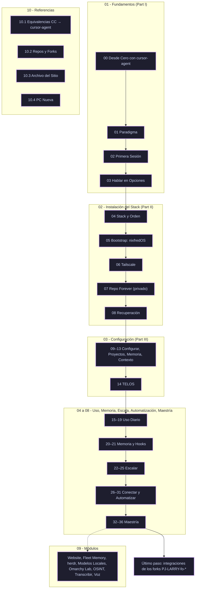

# 🤖 Playbook Larry con cursor-agent (MOC)

> [!NOTE]
> **Bienvenido a tu Vault de Obsidian:**
> Este repositorio es un **playbook ejecutable** para construir un asistente de IA personal en la terminal, siguiendo [how.nixfred.com](https://how.nixfred.com) ("Build Your Own AI: a Field Guide by Larry"), pero con **`cursor-agent`** en lugar de Claude Code y con **[nixfredOS](https://nixfredos.com)** como base en lugar de LifeOS. Un agente lo sigue en orden mientras le explica al humano cómo está armado cada paso.

> [!IMPORTANT]
> **¿Eres un agente?** Empieza por [[PROGRESO (Ledger)|PROGRESO (Ledger)]] y las reglas de `AGENTS.md`. Un capítulo a la vez: leer, ejecutar con permiso, verificar con evidencia, documentar, registrar.

---

## 🗺️ Mapa de Ruta del Playbook

---

## 📚 Índice de Contenidos

Cada capítulo tiene su original archivado en `assets/upstream-site/how.nixfred.com/`. La nota propia se crea cuando el capítulo se ejecuta; hasta entonces el enlace apunta al original.

### 1️⃣ Fundamentos (Part I)
- [[01.0 - Paso 0 - Desde Cero con cursor-agent|00 — Desde Cero con cursor-agent]] ✅: login, modo `--force`, nixbash como capa sobre Omarchy · [[assets/upstream-site/how.nixfred.com/00-start-here|original]]
- [[01.1 - Capitulo 1 - El Paradigma de la Terminal|01 — El Paradigma: Por Qué la IA Vive en la Terminal]] ✅: harness > modelo; línea base del harness · [[assets/upstream-site/how.nixfred.com/01-the-paradigm|original]]
- [[01.2 - Capitulo 2 - Primera Sesion|02 — Primera Sesión: Ganarse la Confianza]] ✅: `AGENTS.md`, barra de estado, atribución desactivada · [[assets/upstream-site/how.nixfred.com/02-first-session|original]]
- [[01.3 - Capitulo 3 - Hablar en Opciones|03 — Hablar en Opciones]] ✅: hábito y nivel como User Rules globales · [[assets/upstream-site/how.nixfred.com/03-ask|original]]

### 2️⃣ Instalación del Stack (Part II)
- [[02.4 - Capitulo 4 - El Stack de Larry|04 — The Larry Stack: Repos y Orden de Instalación]] ✅: los cuatro sistemas traducidos, forks en `~/Projects`, Fabric CLI · [[assets/upstream-site/how.nixfred.com/04-larry-stack|original]]
- [[02.5 - Capitulo 5 - nixfredOS en cursor-agent|05 — The One-Command Bootstrap → nixfredOS en cursor-agent]] ✅: Sura / Robert, constitución por hook, hooks de Claude adaptados, memoria, voz, Interceptor · [[assets/upstream-site/how.nixfred.com/05-bootstrap|original]] · [[assets/upstream-site/nixfredos.com/install|nixfredOS install]]
- [[02.6 - Capitulo 6 - Tailscale|06 — Tailscale y la Malla Multi-Host]] ✅: PC `her` en la tailnet, MagicDNS, Tailscale SSH · [[assets/upstream-site/how.nixfred.com/06-tailscale|original]]
- [[02.7 - Capitulo 7 - Repos Privados para Siempre|07 — Repos Privados para Siempre (y gup)]] ✅: `sura-brain`, `sura-brain-user`, `sura-conversations`, `sura-home` · [[assets/upstream-site/how.nixfred.com/07-forever-repo|original]]
- [[02.8 - Capitulo 8 - Recuperacion ante Desastres|08 — Disaster Recovery & Continuity]] ✅: `restore.sh`, manifiesto de paquetes por hook de pacman, restore probado en `melitta` · [[assets/upstream-site/how.nixfred.com/08-recovery|original]]

### 3️⃣ Configuración (Part III)
- [[03.9 - Capitulo 9 - Configurar, no Chatear|09 — Setup Beats Model: Configurar, no Chatear]] ✅: árbol USER personal, estilo y verificación de nixfredOS, correcciones como configuración · [[assets/upstream-site/how.nixfred.com/09-configure|original]]
- [[03.10 - Capitulo 10 - Proyectos, Roles y Referencias|10 — Projects, Roles & Reference Material]] ✅: todo en `~/Projects`, `PROJECTS.md` con alias y privacidad · [[assets/upstream-site/how.nixfred.com/10-projects|original]]
- [[03.11 - Capitulo 11 - Memoria Viva|11 — CLAUDE.md, context.md & Memory → Memoria viva]] ✅: adaptador `claude` → `cursor-agent`, extracción LMF4, búsqueda semántica con Ollama · [[assets/upstream-site/how.nixfred.com/11-memory-files|original]]
- 12 — Prompt Libraries, Templates & Quality Bars · [[assets/upstream-site/how.nixfred.com/12-prompt-library|original]]
- 13 — Context Discipline · [[assets/upstream-site/how.nixfred.com/13-context|original]]
- 14 — TELOS · [[assets/upstream-site/how.nixfred.com/14-telos|original]] · [[assets/upstream-site/how.nixfred.com/telos-questions|preguntas]]

### 4️⃣ Uso Diario (Part IV)
- 15 — Prompting Is a Skill · [[assets/upstream-site/how.nixfred.com/15-prompting|original]]
- 16 — Plan, Prototype, Build · [[assets/upstream-site/how.nixfred.com/16-plan-build|original]]
- 17 — Slash Commands & Dual-Use Tooling · [[assets/upstream-site/how.nixfred.com/17-slash|original]]
- 18 — Models, Thinking & Cost · [[assets/upstream-site/how.nixfred.com/18-models|original]]
- 19 — Permissions & Safe Autonomy · [[assets/upstream-site/how.nixfred.com/19-permissions|original]]

### 5️⃣ Memoria y Reglas (Part V)
- 20 — Compounding Engineering · [[assets/upstream-site/how.nixfred.com/20-compounding|original]]
- 21 — Hooks: Determinism You Can't Skip · [[assets/upstream-site/how.nixfred.com/21-hooks|original]]

### 6️⃣ Escalar (Part VI)
- 22 — Subagents & Forked Context · [[assets/upstream-site/how.nixfred.com/22-subagents|original]]
- 23 — Swarms, Migrations & Agent Teams · [[assets/upstream-site/how.nixfred.com/23-swarms|original]]
- 24 — Dynamic Workflows & Ultracode · [[assets/upstream-site/how.nixfred.com/24-workflows|original]]
- 25 — Tacit Knowledge & Code Reuse · [[assets/upstream-site/how.nixfred.com/25-tacit|original]]

### 7️⃣ Conectar y Automatizar (Part VII)
- 26 — Connectors: Email, Calendar, Docs, Slack, Web · [[assets/upstream-site/how.nixfred.com/26-connectors|original]]
- 27 — Beyond Chat: Desktop, Files & Folders · [[assets/upstream-site/how.nixfred.com/27-beyond-chat|original]]
- 28 — Routines: The Laptop-Off Teammate · [[assets/upstream-site/how.nixfred.com/28-routines|original]]
- 29 — Designing & Deploying Routines · [[assets/upstream-site/how.nixfred.com/29-routine-design|original]]
- 30 — Repeatable Systems · [[assets/upstream-site/how.nixfred.com/30-systems|original]]
- 31 — Claude Everywhere + The Ecosystem · [[assets/upstream-site/how.nixfred.com/31-everywhere|original]]

### 8️⃣ Maestría (Part VIII)
- 32 — Multi-Agent Patterns · [[assets/upstream-site/how.nixfred.com/32-multi-agent-patterns|original]]
- 33 — Compounding Engineering, Done Properly · [[assets/upstream-site/how.nixfred.com/33-compounding-advanced|original]]
- 34 — Proactive Agents: Routines Done Right · [[assets/upstream-site/how.nixfred.com/34-routines-advanced|original]]
- 35 — Principles of an AI-Grade Setup · [[assets/upstream-site/how.nixfred.com/35-principles|original]]
- 36 — Your Operating Manual + Larry's Field Notes · [[assets/upstream-site/how.nixfred.com/36-operating-manual|original]]

### 9️⃣ Módulos
- Build & Deploy a Real Website · [[assets/upstream-site/how.nixfred.com/build-website|original]]
- Centralize Your Memory Across a Fleet · [[assets/upstream-site/how.nixfred.com/fleet-memory|original]]
- Persistent Agent Sessions With herdr · [[assets/upstream-site/how.nixfred.com/herdr-sessions|original]]
- Local LLMs and a Local or Cloud Router · [[assets/upstream-site/how.nixfred.com/local-models-router|original]]
- A Lab Machine: Omarchy Linux for AI Experiments · [[assets/upstream-site/how.nixfred.com/omarchy-linux-rd|original]]
- Teach Your AI OSINT · [[assets/upstream-site/how.nixfred.com/osint|original]]
- Transcribe X, Video & Audio · [[assets/upstream-site/how.nixfred.com/transcribe-video|original]]
- Voice Dictation · [[assets/upstream-site/how.nixfred.com/voice-dictation|original]]

### 🔟 Referencias
- [[10.1 - Equivalencias Claude Code a cursor-agent|10.1 — Equivalencias Claude Code → cursor-agent]]: traducción de comandos, archivos y capas; qué no aplica y por qué.
- [[10.2 - Repositorios Upstream y Forks|10.2 — Repositorios Upstream y Forks]]: los 10 forks `PJ-LARRY-fo-*`, sus commits base y cómo clonarlos.
- [[10.3 - Archivo del Sitio how.nixfred.com|10.3 — Archivo del Sitio]]: copia del sitio y de nixfredos.com, y cómo regenerarla.
- [[10.4 - Reconstruir en una PC Nueva|10.4 — Reconstruir en una PC Nueva]]: pasos del humano, `assets/rebuild.sh`, decisiones ya tomadas y trampas conocidas.
- [[PROGRESO (Ledger)|📒 PROGRESO (Ledger)]]: dónde vamos.

### 🏁 Último paso
- Integraciones de los forks `PJ-LARRY-fo-*` al estilo `PJ-NIRI-fo-*`: workflow `sync-personal-fork`, agentes PM/RV/WK en `.agents/agents`, `AGENTS.md` y `docs/agents/`.

---

## 🤝 Créditos y Reconocimientos

- **Guía original:** [how.nixfred.com](https://how.nixfred.com), de Fred Nix y Larry ([nixfred.com](https://nixfred.com)).
- **Base del sistema:** [nixfred/nixfredOS](https://github.com/nixfred/nixfredOS), fork de [danielmiessler/LifeOS](https://github.com/danielmiessler/LifeOS) (MIT).
- **Daniel Miessler:** [Telos](https://github.com/danielmiessler/Telos), [Fabric](https://github.com/danielmiessler/Fabric).
- **Harness:** [Cursor CLI](https://cursor.com/cli) (`cursor-agent`).
