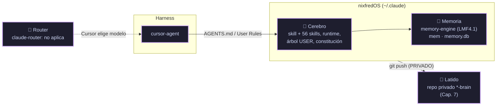

# 🧱 Capítulo 4: El Stack de Larry — Repos y Orden de Instalación

> [!NOTE]
> **Hoja de Ruta:**
> * Anterior: [[01.3 - Capitulo 3 - Hablar en Opciones|Capítulo 3: Hablar en Opciones]]
> **👉 Capítulo 4 (esta nota):** el mapa de piezas y el orden de instalación, traducido a `cursor-agent` + nixfredOS. Se clonan y leen los repos; la instalación de nixfredOS es el Capítulo 5.
> * Siguiente: Capítulo 5 — Bootstrap: nixfredOS (nota pendiente de crear)
> * Original: [[assets/upstream-site/how.nixfred.com/04-larry-stack|Chapter 4: The Larry Stack]] · <https://how.nixfred.com/04-larry-stack.html>
> * Volver a: [[00 - Indice General (MOC)|Índice General]]

> [!SUCCESS]
> **Completado el 2026-10-12.** Empieza la Part II (Instalación del Stack).

---

## 🗺️ Los cuatro sistemas, traducidos

El original describe al asistente como cuatro sistemas que cooperan. En este playbook, **nixfredOS absorbe dos de ellos** (Cerebro y Memoria) y uno no aplica a Cursor.



| Sistema | Original (Claude Code) | Este playbook (`cursor-agent`) |
|---|---|---|
| 🧠 **Cerebro** (PAI) | [LifeOS](https://github.com/danielmiessler/LifeOS) en `~/.claude/` | **nixfredOS** (fork de LifeOS) desde el submódulo `nixfredOS/`. Cursor lo carga como contexto vía `AGENTS.md`/User Rules; los hooks always-on no se cablean en Cursor (roadmap de nixfredOS). |
| 💓 **Latido** (PF) | Repo privado `*_forever` + [nixnet](https://github.com/nixfred/nixnet) | Repo **PRIVADO** `<nombre>-brain` de nixfredOS (`INSTALL.md` §8.7), en el Capítulo 7. nixnet apunta a Ubuntu (`apt`, `yq`): se evalúa en Arch en el Capítulo 7. |
| 💾 **Memoria** (CCF) | [LMF4.1](https://github.com/nixfred/lmf4.1) standalone | El **memory-engine** que nixfredOS ya trae (LMF4.1 empaquetado, `INSTALL.md` §8.6). El fork `lmf4.1` queda como referencia. |
| 🔀 **Router** (CR) | [claude-router](https://github.com/nixfred/claude-router) | **No aplica**: v4 es un *mod* de Claude Code (`turn.step`, `agent.spawn`) que reparte entre Opus/Sonnet/Haiku. En Cursor el modelo lo elige `Auto` o `--model`. Fork conservado. |

---

## 🪜 El orden de instalación, con estado

| # | Tier | Original | Este playbook | Estado |
|---|---|---|---|---|
| 0 | Base | Claude Code | `cursor-agent` 2026.10.01 | ✅ [[01.0 - Paso 0 - Desde Cero con cursor-agent\|Paso 0]] |
| 1 | Base | Tailscale | Igual (`pacman`) | ⏳ Capítulo 6 |
| 2 | Base | nixbash | Capa sobre el bashrc de Omarchy ([PJ-LARRY-fo-nixbash#1](https://github.com/robert-flo/PJ-LARRY-fo-nixbash/pull/1)) | ✅ Paso 0 |
| 3 | Cerebro | PAI / LifeOS | **nixfredOS** (Core) | ⏳ Capítulo 5 |
| 3b | Cerebro | Fabric CLI | `fabric` compilado desde el fork | ✅ instalado · ⚙️ configuración en el último paso |
| 4 | Memoria | LMF4.1 | memory-engine de nixfredOS | ⏳ Capítulo 5 (instalar) · Capítulo 11 (extractor y Ollama) |
| 5 | Memoria | Memoria curada | `~/.claude/MEMORY/` + reglas | ⏳ Capítulo 11 |
| 6 | Latido | `*_forever` / nixnet | Repo privado `*-brain` | ⏳ Capítulo 7 |
| 7 | Router | claude-router | No aplica | — Capítulo 18 lo confirma |
| 8 | Capacidades | claude-on-mac | No aplica: no hay Mac en esta máquina | — fork conservado |
| 9 | Capacidades | skills / Fabric / MCP | Skills de nixfredOS, MCP de Cursor, [x.api](https://github.com/nixfred/x.api) (API de X de pago por uso) | ⏳ Capítulos 17 y 26 |
| — | Contexto | TELOS | [Telos](https://github.com/danielmiessler/Telos) | ⏳ Capítulo 14 |
| — | Escritorio | — | [infomarchy](https://github.com/nixfred/infomarchy): plugin de Omarchy que muestra en el fondo de pantalla los agentes activos (detecta Cursor) | ⏳ Módulo Omarchy Lab |
| — | Recuperación | Clonar el `*_forever` | Clonar el `*-brain` | ⏳ Capítulo 8 |

> [!IMPORTANT]
> **Por qué este orden.** Memoria y respaldo (4–6) deben existir antes de volcar horas de identidad en el Cerebro; si el disco muere sin respaldo, la identidad se pierde. Por eso TELOS (lo más personal) espera al Capítulo 14, después del repo privado del Capítulo 7.

---

## 📂 Dónde vive cada cosa

| Capa | Ruta | Repo | Visibilidad |
|---|---|---|---|
| **A — Identidad** | `~/.claude/` (datos de nixfredOS, aunque el harness sea Cursor) | `<nombre>-brain` (Cap. 7) | 🔒 PRIVADO, siempre |
| **A — Datos USER** | `~/.config/NIXFREDOS/USER/` (enlazado desde `~/.claude/NIXFREDOS/USER`) | Segundo repo privado si es symlink (Cap. 7) | 🔒 PRIVADO |
| **B — Trabajo** | `~/Projects/<repo>/` | Un repo por proyecto | Mixta |
| **B — Experimentos** | `/zt/AAAA-MM-DD-dueño-repo/` (este vault incluido) | Un repo por experimento | Mixta |

**Decisión del humano (2026-10-12):** nixfredOS usa `~/.claude` como carpeta de datos. Unos 340 archivos del runtime (hooks, memory-engine, herramientas) asumen esa ruta; moverla a `~/.cursor` obligaría a parchear el fork en todas partes.

---

## 🔧 Lo que se hizo

### 1. Prerequisitos de nixfredOS

| Necesita | Estado |
|---|---|
| Linux moderno | ✅ Omarchy (Arch), kernel 7.2.5 |
| `git`, `curl` | ✅ 2.55.0 · 8.22.0 |
| `bun` 1.2+ | ✅ 1.4.3 (mise) |
| `gh` + cuenta | ✅ 2.102.0, `robert-flo` por SSH |
| Harness | ✅ `cursor-agent` |
| Ollama (opcional) | ❌ no instalado · **se decide en el Capítulo 11** |
| GPU | Solo Intel HD 530 (sin GPU dedicada), 15 GB RAM: `nomic-embed-text` va bien en CPU; `llama3.1:8b` (~4.7 GB) sería lento |

### 2. Forks clonados y leídos en `~/Projects`

Con el patrón de [[10.2 - Repositorios Upstream y Forks|10.2]] (origen SSH al fork, `upstream` con push `DISABLE`):

```bash
cd ~/Projects
clone_fork() { git clone -q $4 -b personal "git@github.com:robert-flo/$2.git" "$1" \
  && git -C "$1" remote add upstream "https://github.com/$3.git" \
  && git -C "$1" remote set-url --push upstream DISABLE; }
clone_fork lmf4.1        PJ-LARRY-fo-lmf4.1        nixfred/lmf4.1
clone_fork nixnet        PJ-LARRY-fo-nixnet        nixfred/nixnet
clone_fork claude-router PJ-LARRY-fo-claude-router nixfred/claude-router
clone_fork claude-on-mac PJ-LARRY-fo-claude-on-mac nixfred/claude-on-mac
clone_fork x.api         PJ-LARRY-fo-x.api         nixfred/x.api
clone_fork infomarchy    PJ-LARRY-fo-infomarchy    nixfred/infomarchy
clone_fork Telos         PJ-LARRY-fo-Telos         danielmiessler/Telos
clone_fork Fabric        PJ-LARRY-fo-Fabric        danielmiessler/Fabric --depth=1   # 155 MB
```

nixfredOS no se clona aparte: es el submódulo `nixfredOS/` del vault.

### 3. Fabric CLI compilado desde el fork

El instalador oficial baja el binario de las releases de `danielmiessler/fabric`, y el fork no tiene releases. No hay paquete en `pacman` ni en `mise`. Se compiló desde el fork con un Go temporal de mise (sin registrarlo en la configuración global):

```bash
cd ~/Projects/Fabric
mise x go@1.27.2 -- go build -trimpath -o ~/.local/bin/fabric ./cmd/fabric
fabric --version   # v1.4.518
```

> [!NOTE]
> **Configuración pospuesta al último paso** (decisión del humano). Al correr `fabric --setup`, apuntar los repos de patterns y strategies al fork: el código usa por defecto `https://github.com/danielmiessler/fabric.git` (`internal/tools/patterns_loader.go`, `internal/plugins/strategy/strategy.go`). El CLI no puede usar el plan de Cursor: necesita una API key o Ollama. Mientras tanto, nixfredOS trae una skill de Fabric.

---

## ⚠️ Trampas encontradas

> [!WARNING]
> **1. En Omarchy, `claude` instala Claude Code.** `~/.local/bin/claude` es un shim de Omarchy que ejecuta `mise use -g claude` antes de lanzar Claude Code. Al correr `claude --version` para inspeccionarlo, se instaló Claude Code 2.1.296 y se añadió `claude = "latest"` a `~/.config/mise/config.toml`. Se revirtió (`mise unuse -g claude`, `mise uninstall claude --all` y borrado de los enlaces que quedaban). **Regla: no ejecutar `claude` en esta máquina**, ni siquiera con `--version`. Lo mismo vale para los otros shims de Omarchy.

> [!WARNING]
> **2. `DetectEnv` detecta mal el harness.** Devuelve `claude-code` con confianza `detected` porque `~/.claude/` existe (Omarchy lo crea para sus skills `omarchy` y `diagnose-crash`) y el shim `claude` está en el `PATH`. Para Cursor busca el binario `cursor` (el IDE), no `cursor-agent`. Las herramientas de despliegue (`DeployCore`, `ScaffoldUser`, `LinkUser`) **no** usan esa detección: instalan en `--config-root` o `CLAUDE_CONFIG_DIR`, y si no hay ninguno, en `~/.claude`. En el Capítulo 5 se pasa `--config-root ~/.claude` explícito y se sigue la rama "otro harness" del `INSTALL.md` (§6 y §7).

> [!WARNING]
> **3. El fork no tiene releases ni tags.** `install.sh` resuelve la última release de `NIXFREDOS_REPO` (por defecto `nixfred/nixfredOS`, que va en `v1.5.0`). Contra el fork fallaría y caería al tag de respaldo. En el Capítulo 5 se instala desde el submódulo local (`INSTALL.md` §2 permite "un directorio de release local"), que fija el commit del fork.

> [!WARNING]
> **4. El memory-engine depende de Claude Code en dos sitios.** El extractor (`SessionExtract`) usa `ollama:llama3.1:8b` por defecto y, si no, `claude --print`. El instalador registra su servidor MCP con `claude mcp add`. En Cursor: MCP en `~/.cursor/mcp.json` (Capítulo 5) y extractor por Ollama o adaptado a `cursor-agent -p` (Capítulo 11). Además, los transcripts de `cursor-agent` viven en `~/.cursor/projects/*/agent-transcripts/`, no en `~/.claude/projects/`.

---

## 🔍 Verificación

```bash
cd ~/Projects && for d in */; do printf '%-15s %s  %s\n' "${d%/}" \
  "$(git -C $d log -1 --format=%h)" "$(git -C $d remote get-url --push upstream)"; done
```
```text
claude-on-mac   3f93270  DISABLE
claude-router   2f744e5  DISABLE
Fabric          177b3a9  DISABLE
infomarchy      dc15afa  DISABLE
lmf4.1          ca0fbe5  DISABLE
nixbash         0f6ab2f  DISABLE
nixnet          07c34f4  DISABLE
Telos           e5cc4d6  DISABLE
x.api           aa1c600  DISABLE
```

Los commits coinciden con los commits base de [[10.2 - Repositorios Upstream y Forks|10.2]] (nixbash está en su `personal` con el PR #1).

```bash
fabric --version                                   # v1.4.518
rg -c claude ~/.config/mise/config.toml || echo "sin claude"   # sin claude
bun nixfredOS/nixfredOS/Tools/DetectEnv.ts | jq -c '{h:.harness.name,c:.harness.confidence,existingInstall,isDevTree}'
# {"h":"claude-code","c":"detected","existingInstall":false,"isDevTree":false}   ← trampa 2
```

> [!CHECKLIST]
> - [x] Mapa de los cuatro sistemas traducido a `cursor-agent` + nixfredOS.
> - [x] Repos del stack clonados en `~/Projects` desde los forks y leídos.
> - [x] Prerequisitos de nixfredOS comprobados.
> - [x] Decisiones del humano: datos en `~/.claude`; Ollama en el Capítulo 11; Fabric CLI instalado ahora y configurado en el último paso.
> - [x] Fabric CLI compilado desde el fork.
> - [x] Instalación accidental de Claude Code revertida y documentada.
> - [x] Registrado en [[PROGRESO (Ledger)|PROGRESO]].

---

## 🔗 Continuar con el Siguiente Paso

- Capítulo 5 — The One-Command Bootstrap → **nixfredOS** ([[assets/upstream-site/how.nixfred.com/05-bootstrap|original]] · [[assets/upstream-site/nixfredos.com/install|nixfredOS install]]): instalar el Core desde el submódulo, cablear el contexto para Cursor y nombrar al asistente.
- [[10.1 - Equivalencias Claude Code a cursor-agent|🔁 Equivalencias Claude Code → cursor-agent]]
