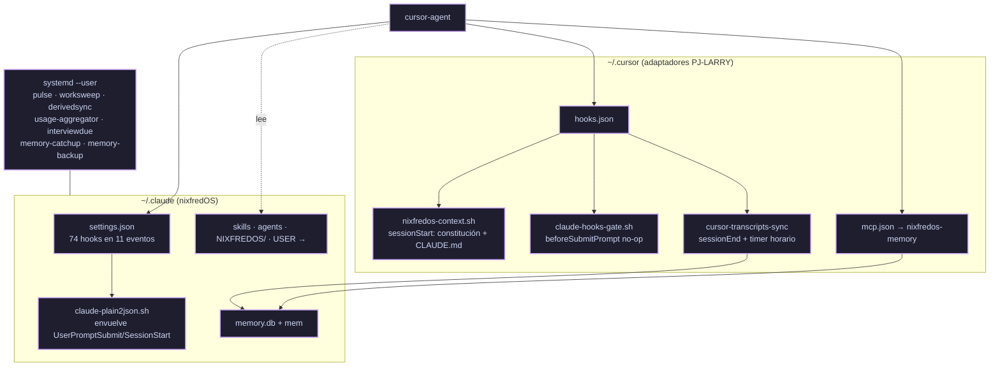

# 🚀 Capítulo 5: Bootstrap — nixfredOS en cursor-agent

> [!NOTE]
> **Hoja de Ruta:**
> * Anterior: [[02.4 - Capitulo 4 - El Stack de Larry|Capítulo 4: El Stack de Larry]]
> **👉 Capítulo 5 (esta nota):** nixfredOS instalado en `~/.claude` y funcionando dentro de `cursor-agent`: constitución, identidad, hooks, memoria, servicios y extras.
> * Siguiente: [[02.6 - Capitulo 6 - Tailscale|Capítulo 6: Tailscale]]
> * Original: [[assets/upstream-site/how.nixfred.com/05-bootstrap|Chapter 5: The One-Command Bootstrap]] · [[assets/upstream-site/nixfredos.com/install|nixfredOS install]]
> * Volver a: [[00 - Indice General (MOC)|Índice General]]

> [!SUCCESS]
> **Completado el 2026-10-12.** Una sesión nueva de `cursor-agent` responde "Sura, Robert.", recibe la constitución completa, ejecuta los 74 hooks de nixfredOS y guarda memorias.

---

## 🧭 Decisiones del humano

| Decisión | Valor |
|---|---|
| Nombre del asistente | **Sura** (renombrar el usuario Linux `sura` y los playbooks de niri queda como tarea futura del humano) |
| Principal | **Robert**, `America/El_Salvador` |
| Carga de la constitución | Hook nativo de Cursor (`sessionStart`) |
| Shim `claude` de Omarchy | Sustituido por una guardia que rechaza y registra |
| Extras | Todo lo opcional, menos Claude Code y lo exclusivo de macOS |
| Memoria | El camino de nixfredOS: SQLite local + repo privado (Cap. 7). **Honcho descartado**: manda las conversaciones a un tercero y rompe ese diseño |
| `RememberTrigger` | Se queda en inglés ("remember …") |
| Barra de estado | La propia de `cursor-agent` + un segmento corto de nixfredOS (sección 10 de "Lo que se hizo") |

---

## 🗺️ Cómo encaja nixfredOS en Cursor

nixfredOS está escrito para Claude Code. `cursor-agent` entiende parte de ese formato, y lo que falta lo cubren adaptadores en `~/.cursor/` (fuente: `assets/home/.cursor/`).



### Qué lee `cursor-agent` de `~/.claude`

Comprobado con canarios y leyendo el código de `cursor-agent` 2026.10.01:

| Pieza | ¿La usa? | Detalle |
|---|---|---|
| Hooks de `~/.claude/settings.json` | ✅ con condiciones | Solo si alguna entrada tiene la clave `matcher`. Eventos: `PreToolUse`, `PostToolUse`, `UserPromptSubmit`, `Stop`, `SubagentStop`, `SessionStart`, `SessionEnd`, `PreCompact`. Ignora `PermissionRequest` y `Notification` |
| Skills de `~/.claude/skills` | ✅ | Aparecen como skills de terceros |
| Agentes de `~/.claude/agents` | ✅ | |
| `~/.claude/CLAUDE.md` | ❌ | Por eso existe el cargador `sessionStart` |
| `permissions` de `settings.json` | ❌ | Las reglas `deny` no se aplicaron ni con sintaxis `Bash()` ni `Shell()` |

> [!IMPORTANT]
> **Tres reglas de `cursor-agent` que no están documentadas** (sacadas del código y verificadas):
> 1. Los hooks `UserPromptSubmit` de Claude **solo corren en sesión interactiva y si `~/.cursor/hooks.json` declara al menos un `beforeSubmitPrompt` nativo**. Sin él, ningún hook de prompt se ejecuta. `claude-hooks-gate.sh` es ese no-op.
> 2. La salida en **texto plano** de un hook se descarta; solo cuenta JSON (`hookSpecificOutput.additionalContext`). Claude Code sí inyecta texto plano, y así escriben `MemoryTurnStart`, `TimeContext`, `RememberTrigger` y `AssociativeRecall`. `claude-plain2json.sh` lo convierte.
> 3. El contexto de todos los hooks de un mismo `beforeSubmitPrompt` se concatena y, **si pasa de 10.000 caracteres, se descarta entero**. `sessionStart` no tiene ese límite (entran 48 KB). Hoy los hooks de prompt suman ~2 KB; la memoria de `MemoryTurnStart` puede crecer hasta ~12 KB, así que hay que vigilarlo.

Diferencias de payload frente a Claude Code: `hook_event_name` en camelCase (`beforeSubmitPrompt`, `preToolUse`), la herramienta de shell se llama `Shell` (no `Bash`), y `transcript_path` es `null` salvo en `Stop`.

---

## 🔧 Lo que se hizo

Todo con `--config-root ~/.claude`, desde la copia del submódulo (commit del fork `personal`). **No** se usó `install.sh`: acaba en `exec claude "/nixfredOS setup"` y añade un alias que lanza `claude`.

### 1. Guardia de `claude`

`~/.local/bin/claude` (fuente: `assets/home/.local/bin/claude`) sustituye al shim de Omarchy. Sale con código 127 y registra cada intento, con quién lo llamó, en `~/.local/state/claude-guard.log`. El original quedó en `~/.local/bin/claude.omarchy-wrapper.bak` y se restaura con `omarchy-mise-install claude`.

En uso normal, la única función que tropieza con la guardia es el nombrador de sesiones de `PromptProcessing` (`claude --print --model sonnet`), que cae a un nombre determinista sin romper nada.

### 2. Core

```bash
tar -C ~ -czf ~/.claude.backup.$(date +%Y%m%d-%H%M%S).tgz .claude     # snapshot previo
cp -R <vault>/nixfredOS/nixfredOS ~/.claude/skills/nixfredOS
cd ~/.claude/skills/nixfredOS
bun Tools/DeployCore.ts      --config-root ~/.claude --apply   # 942 archivos de skills + 803 del runtime, bun install
cp install/CLAUDE.template.md ~/.claude/CLAUDE.md
bun Tools/InstallSettings.ts --config-root ~/.claude --apply   # settings.json (28 claves, env NIXFREDOS_DIR…)
bun Tools/ScaffoldUser.ts    --config-root ~/.claude --apply   # ~/.config/NIXFREDOS/USER (103 archivos)
bun Tools/LinkUser.ts        --config-root ~/.claude --apply   # ~/.claude/NIXFREDOS/USER → ~/.config/NIXFREDOS/USER
```

### 3. Identidad

| Archivo (en `~/.config/NIXFREDOS/USER/`) | Cambio |
|---|---|
| `CONFIG/NIXFREDOS_CONFIG.toml` | `principal.name = "Robert"`, `timezone = "America/El_Salvador"`; `da.name`, `full_name`, `display_name = "Sura"` |
| `DIGITAL_ASSISTANT/DA_IDENTITY.md` | Nombre Sura, procedencia "interview", "I am Sura, Robert's AI assistant." |
| `PRINCIPAL/PRINCIPAL_IDENTITY.md` | Robert, El Salvador, `America/El_Salvador` |
| `BASICINFO.md` | Zona horaria |

```bash
bun Tools/ActivateImports.ts --config-root ~/.claude --apply   # 6 @-imports activos en CLAUDE.md
```

### 4. Hooks, componentes y servicios

```bash
bun Tools/InstallHooks.ts     --config-root ~/.claude --apply  # 98 archivos, 74 entradas en 11 eventos
bun Tools/DeployComponents.ts --config-root ~/.claude \
  --components agents,commands,pulse,worksweep,derivedsync,usage-aggregator --apply
bun ~/.claude/NIXFREDOS/TOOLS/Services.ts install --only interviewdue --yes
```

| Componente | Estado | Motivo |
|---|---|---|
| agents (8), commands (7) | ✅ | |
| pulse (`127.0.0.1:31337`), worksweep, derivedsync, usage-aggregator, interviewdue | ✅ systemd `--user` | |
| tooltips, spinnerverbs | ✗ | Solo interfaz de Claude Code |
| deriver, conduit.insight, blogdiscovery | ✗ | Llaman a `claude` |
| conduit, pegwatch, pulse-menubar | ✗ | Solo macOS |
| healthsync | ✗ | Necesita una fuente (p. ej. Oura) |
| commitmentsweep | ✗ | Sin datos todavía |
| codexupdate | ✗ | Choca con el codex que gestiona mise |
| bookmark-watchdog, backups, amberroute | ✗ | Sin instalador |

### 5. Placeholders de identidad

```bash
bun <vault>/assets/nixfredos-substitute.ts          # aplica; --check solo comprueba
```

Lee los nombres de `NIXFREDOS_CONFIG.toml` y rinde `{{DA_NAME}}`, `{{PRINCIPAL_NAME}}`, etc. en `NIXFREDOS/`, `USER/`, `hooks/`, `agents/`, `commands/` y las skills. El Doctor lo verifica.

### 6. Cargador de la constitución

`~/.cursor/hooks/nixfredos-context.sh` (en `sessionStart`) inyecta `NIXFREDOS_SYSTEM_PROMPT.md` y luego `CLAUDE.md` con sus `@`-imports expandidos: 48 KB en 23 ms, en el mismo orden que usa el lanzador `nixfredos` de Claude Code (`--append-system-prompt-file`). Si falta un archivo, no inyecta nada y la sesión arranca sin nixfredOS.

### 7. Hooks de prompt en Cursor

```bash
~/.cursor/hooks/wrap-claude-hooks.sh          # idempotente; --check para verificar
```

Envuelve cada comando `UserPromptSubmit` y `SessionStart` de `settings.json` con `claude-plain2json.sh <Evento> <comando>`. **Hay que repetirlo tras reinstalar nixfredOS o el memory-engine**, porque reescriben esas entradas (`rebuild.sh` lo hace).

### 8. Memory engine

```bash
cd ~/.claude/skills/nixfredOS/install/memory-engine && ./install
mv ~/.claude/memory.db ~/.claude/memory.db.installer-schema.bak && ~/bin/mem init
ln -sfn ~/bin/mem ~/.local/bin/mem
```

- MCP registrado en `~/.cursor/mcp.json` (`cursor-agent mcp list` → `nixfredos-memory: ready`, herramientas `memory_search` y `memory_recall`).
- Timers `memory-catchup` y `memory-backup` (cada 4 h). El repo de backup `~/.claude/conversations-backup` es local, sin remoto hasta el Capítulo 7.
- `cursor-transcripts-sync.ts` copia los transcripts de Cursor al formato de Claude en `~/.claude/projects/` y los carga con el `mem import` del motor. Corre al cerrar cada sesión (`sessionEnd` nativo, sin bloquearla) y cada hora (`cursor-transcripts-sync.timer`). Log: `~/.local/state/cursor-transcripts-sync.log`.

| Capa | Estado |
|---|---|
| "remember X" → archivo en `~/.claude/MEMORY/AUTO/` | ✅ (solo en inglés) |
| Memoria del principal inyectada en cada prompt (`MemoryTurnStart`) | ✅ |
| Conversaciones buscables: `mem search <palabras>` | ✅ 40 sesiones, ~700 mensajes al cerrar el capítulo |
| Conocimiento extraído (decisiones, errores, aprendizajes) para el MCP y `AssociativeRecall` | ⏳ Capítulo 11: el extractor necesita Ollama o adaptarse a `cursor-agent -p` |

### 9. Extras

| Extra | Estado |
|---|---|
| Voz | ✅ piper (`piper-tts-bin` de AUR, enlazado como `/usr/local/bin/piper` para que lo vea Pulse) con la voz `es_MX-claude-high`; espeak-ng de respaldo. Interruptor: `nixfredos-voice on/off` |
| Interceptor | ✅ CLI + daemon + native host v2.1.0 (tarball Browser linux-x64, SHA256 verificado) en `~/.local/share/interceptor/2.1.0`. Falta la parte humana |
| Codex | Instalado por mise. Falta `codex login` (humano) |
| Cloudflare | Falta crear un API token y ponerlo en `~/.claude/.env` (humano) |

### 10. Barra de estado

La barra de nixfredOS (`statusline-command.sh`) está pensada para Claude Code. Se mantuvo la de `cursor-agent` (modelo, contexto, rama y uso de Cursor) y se le añadió un segmento corto al final de la línea de sesión:

```text
… ⎇ master │ Sura mem 40 · hooks ✓ · voz on
```

| Parte | Qué comprueba | Colores |
|---|---|---|
| `Sura` | `[da].name` de `NIXFREDOS_CONFIG.toml` | — |
| `mem 40` | Sesiones en `memory.db` | Verde si el último `mem import` del sync salió bien y hace menos de ~2 h; amarillo si no; `?` rojo si no hay base |
| `hooks ✓` | `~/.cursor/hooks.json` con `sessionStart`, `beforeSubmitPrompt` y `sessionEnd`, `wrap-claude-hooks.sh --check` y el system prompt presente | Verde `✓` / rojo `✗` |
| `voz on` | `voice.json` activado y Pulse activo | Verde `on`, gris `off`, rojo `down` (activada pero Pulse caído) |

`~/.config/cursor/statusline-nixfredos.sh` escribe `~/.cache/cursor-statusline/nixfredos.json` en segundo plano; `statusline.sh` solo lee esa caché (se refresca si tiene más de 30 s), igual que con el uso de Cursor, para no acercarse a `timeoutMs` (1,5 s). En pantallas estrechas pasa a la forma corta (`Sura 40 ✓ voz`) y, si tampoco cabe, desaparece. Sin nixfredOS instalado no se muestra.

---

## ⚠️ Trampas encontradas

> [!WARNING]
> **1. `install.sh` y el alias `nixfredos` lanzan `claude`.** Con el shim de Omarchy eso instala Claude Code. Se instaló pieza a pieza con las herramientas de `Tools/`.

> [!WARNING]
> **2. Los hooks de prompt no hacían nada en Cursor**, por las tres reglas de arriba. Síntoma: el modelo nunca veía la hora ni la memoria, y un canario en `UserPromptSubmit` ni siquiera escribía su archivo de entrada. Hizo falta bisecar: el canario sin `matcher` no se carga; con `matcher` pero sin `beforeSubmitPrompt` nativo no corre; con ambos corre, pero el texto plano se pierde.

> [!WARNING]
> **3. `substituteTree` ignora en silencio las claves sin llaves.** Hay que pasar `"{{DA_NAME}}"`, no `"DA_NAME"`: con la clave desnuda reporta `applied: 0` y no avisa.

> [!WARNING]
> **4. Sustituir antes de `InstallHooks` deja placeholders.** `InstallHooks` y `DeployComponents` copian plantillas nuevas. Quedaron 40 `{{PRINCIPAL_NAME}}`/`{{DA_NAME}}` en 20 hooks y 4 agentes hasta repetir la sustitución. Orden correcto: sustituir al final.

> [!WARNING]
> **5. Error de upstream: `Setup.md` sustituye sobre todo `<configRoot>`.** Eso reescribiría la lista `IDENTITY_PLACEHOLDERS` dentro de `skills/nixfredOS/Tools/InstallEngine.ts` (la copia de redistribución). `nixfredos-substitute.ts` excluye `skills/nixfredOS`.

> [!WARNING]
> **6. Error de upstream: el instalador del memory-engine crea `memory.db` con un esquema viejo.** `mem import` falla con `table sessions has no column named git_branch` y `no such table: breadcrumbs`. Arreglo: apartar la base vacía y ejecutar `mem init`.

> [!WARNING]
> **7. `DeployComponents` da "not loaded" en Linux** para servicios que sí están activos: su comprobación está pensada para macOS. Verificar con `systemctl --user` y `curl 127.0.0.1:31337/healthz`.

> [!WARNING]
> **8. worksweep e interviewdue dependen del árbol de hooks** (`Cannot find module '../../hooks/lib/identity'`). Fallan si se despliegan antes de `InstallHooks`.

> [!WARNING]
> **9. `cursor-agent` no expande `${userHome}` en `mcp.json`.** Se usa `bash -c 'exec bun run "$HOME/…"'` para que el archivo sirva en cualquier PC.

> [!WARNING]
> **10. Pulse no ve `~/.local/bin`.** El servicio systemd tiene un `PATH` corto, así que con `piper` solo en `~/.local/bin` elegía espeak. El enlace va en `/usr/local/bin`.

> [!NOTE]
> Ejecutar `cursor-agent` en un directorio hace que Cursor lo indexe (sincroniza hashes del árbol con sus servidores; se ve en `~/.cursor/projects/<ws>/worker.log`). Las pruebas de canarios se hacen en un directorio vacío dedicado, no en `/tmp`.

---

## 🔍 Verificación

```bash
cd ~/.cache/hookbisect/ws && cursor-agent -p --force --trust \
  "Sin herramientas: (1) tu nombre y el de tu humano; (2) su zona horaria; (3) las primeras 6 palabras de 'Project-Specific Rules'."
```
```text
1. Me llamo Sura y mi humano es Robert.
2. Su zona horaria es America/El_Salvador.
3. "Drop project-scoped CLAUDE.md files alongside each"      ← última sección: los 48 KB llegaron
```

Sesión interactiva con `remember that my favorite editor is neovim`:

```text
Guardé que tu editor favorito es neovim en ~/.claude/MEMORY/AUTO/favorite-editor-neovim.md
El bloque time-now indica: martes 2026-10-13, 04:14 UTC (late night).
🧠 MEMORY: F (0/8 fresh) · due: TELOS.md (never reviewed) · no curation runs yet
```

```bash
cursor-agent mcp list                       # nixfredos-memory: ready
mem search neovim -l 1                      # encuentra la conversación
bun ~/.claude/NIXFREDOS/TOOLS/Doctor.ts     # ✅ identidad, hooks, voz, rg, gh, ffmpeg, yt-dlp, fabric, jq
                                            # ❌ codex, Interceptor, Cloudflare: pasos del humano
assets/rebuild.sh --check                   # pasos 8–12 en ✓
```

> [!CHECKLIST]
> - [x] Core, identidad (Sura / Robert) e imports instalados en `~/.claude`.
> - [x] Constitución cargada en cada sesión de `cursor-agent` (hook `sessionStart`).
> - [x] 74 hooks de nixfredOS activos en Cursor, con la puerta `beforeSubmitPrompt` y el conversor de texto plano.
> - [x] Memory engine con MCP en Cursor, `mem` en el PATH y transcripts de Cursor importados.
> - [x] Servicios y timers de nixfredOS activos en systemd `--user`.
> - [x] Guardia de `claude` instalada; el log muestra solo fallos esperados.
> - [x] Extras: voz (piper) e Interceptor (CLI). Codex, extensión de Interceptor y Cloudflare quedan en manos del humano.
> - [x] `assets/rebuild.sh` cubre el capítulo (pasos 8–12) y [[10.4 - Reconstruir en una PC Nueva|10.4]] actualizada.
> - [x] Registrado en [[PROGRESO (Ledger)|PROGRESO]].

---

## 🔗 Continuar con el Siguiente Paso

- [[02.6 - Capitulo 6 - Tailscale|Capítulo 6 — Tailscale]]: la PC en la tailnet con MagicDNS y Tailscale SSH.
- [[10.1 - Equivalencias Claude Code a cursor-agent|🔁 Equivalencias Claude Code → cursor-agent]]
- [[10.4 - Reconstruir en una PC Nueva|💻 Reconstruir en una PC Nueva]]
