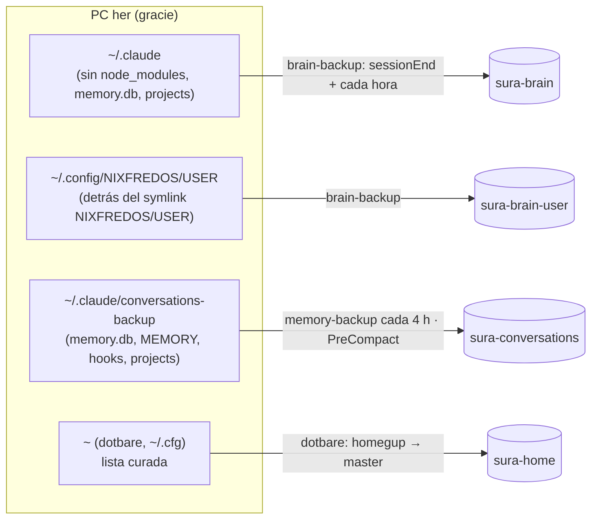

# 🔒 Capítulo 7: Repos privados para siempre (y `gup`)

> [!NOTE]
> **Hoja de Ruta:**
> * Anterior: [[02.6 - Capitulo 6 - Tailscale|Capítulo 6: Tailscale]]
> **👉 Capítulo 7 (esta nota):** el cerebro de Sura, su árbol USER, sus conversaciones y el HOME de `gracie` en cuatro repos privados, con backup automático y `gup`.
> * Siguiente: [[02.8 - Capitulo 8 - Recuperacion ante Desastres|Capítulo 8: Recuperación ante desastres]]
> * Original: [[assets/upstream-site/how.nixfred.com/07-forever-repo|Chapter 7: Your Forever Private Repo (and gup)]] · `nixfredOS/nixfredOS/INSTALL.md` §8.7
> * Volver a: [[00 - Indice General (MOC)|Índice General]]

> [!SUCCESS]
> **Completado el 2026-10-12.** Una sesión real de `cursor-agent` que termina hace commit y push de `sura-brain` y `sura-brain-user` en unos 10 segundos.

---

## 🧭 Decisiones del humano

| Decisión | Valor |
|---|---|
| Nombres | `sura-brain`, `sura-brain-user`, `sura-conversations` (convención `<asistente>-brain` de nixfredOS) y `sura-home` |
| Secretos | **Como Larry: backup completo con secretos**, en repos privados. nixfredOS recomienda lo contrario (limpiar primero); se eligió máxima recuperación |
| `master` directo | **Repos de backup** (`sura-brain`, `sura-brain-user`, `sura-conversations`, `sura-home`): `gup` / `homegup` pueden commitear y empujar a `master` (un commit atómico por invocación). El vault público y el resto de proyectos siguen con rama + PR |
| HOME | Repo `sura-home` con **dotbare** (repo bare en `~/.cfg`), `~/.gitignore` curado (`assets/home/.gitignore`). "Todo lo posible para empezar rápido en otra PC", secretos incluidos |

---

## 🗺️ Qué va a cada repo



| Repo | Origen | Tamaño inicial | Quién hace push |
|---|---|---|---|
| `sura-brain` | `~/.claude` | 4.050 archivos, 42 MB | `brain-backup.sh` (sessionEnd de Cursor + timer horario), `gup` |
| `sura-brain-user` | `~/.config/NIXFREDOS/USER` | 107 archivos | `brain-backup.sh` |
| `sura-conversations` | `~/.claude/conversations-backup` | 160 archivos, 3,7 MB | `memory-backup` (timer de nixfredOS, cada 4 h) y el hook `PreCompact` |
| `sura-home` | `~` vía dotbare | ~285 archivos | A mano: `homegup` (o `gup` fuera de otro repo git) → `master`; `whomegup` = vista previa |

> [!IMPORTANT]
> **Por qué cuatro repos y no uno.** Git guarda el enlace simbólico `NIXFREDOS/USER`, no lo que hay detrás: un commit de `~/.claude` no incluye la identidad, TELOS ni los proyectos. `conversations-backup` ya era un repo propio de nixfredOS. Y el HOME contiene `~/.claude`, que tiene su propio repo.

---

## 🔧 Lo que se hizo

### 1. Repos privados y verificación

```bash
sudo pacman -S --needed gitleaks
for r in sura-brain sura-brain-user sura-conversations; do
  gh repo create robert-flo/$r --private
  gh repo view robert-flo/$r --json visibility -q .visibility   # → PRIVATE
done
```

Antes de cada primer push se vuelve a comprobar `PRIVATE` y se lee `git remote -v` (Law 11). Remotos por SSH, rama `master` (nixfredOS usa `main`; aquí manda la regla del humano).

### 2. `sura-brain` (`~/.claude`)

`~/.claude` no era un repo (en el sitio lo crea el bootstrap; aquí se instaló por partes). `.gitignore` (copia en `assets/home/.claude/gitignore`):

| Fuera | Por qué |
|---|---|
| `node_modules/` | 1,8 GB de los 1,9 GB; reproducibles desde el submódulo; binarios `next-swc` de 143 MB superan el límite de 100 MB de GitHub |
| `memory.db*`, `projects/` | Ya los guarda `memory-backup` en `sura-conversations`: un binario de 1,4 MB que cambia en cada sesión no debe ir a dos repos |
| `conversations-backup/` | Es su propio repo |
| `*.log`, `*.sock`, `*.pid` | Transitorios |
| `interceptor-screenshot-*`, `interceptor-capture-*`, `interceptor-macos-screenshot-*` | Reglas del `install.sh` de nixfredOS: las capturas pueden contener páginas autenticadas |

```bash
cd ~/.claude && git init -b master && git add -A
gitleaks git --pre-commit --staged --redact .     # 8 hallazgos, todos ejemplos del código público de nixfredOS
git commit -m "init: sura brain"
git remote add origin git@github.com:robert-flo/sura-brain.git && git push -u origin master
```

> [!NOTE]
> **Sin conflictos con nixfredOS.** `VersionDrift.hook.ts` lee el Git de `~/.claude` pero no hace nada sin tags semver (no se crean). `PublicPushGate` solo actúa en repos públicos. `PreCompact.hook.sh` hace commit y push de `conversations-backup` por su cuenta.

### 3. `sura-brain-user` y `sura-conversations`

El árbol USER se inicializó igual (gitleaks: 0). `conversations-backup` ya tenía su commit inicial: se le añadió el remoto y se ejecutó `~/bin/memory-backup`, que copió `memory.db`, `MEMORY/`, `hooks/` y `projects/` (41 sesiones) y empujó.

### 4. Latido de backup: `brain-backup.sh`

Adaptado de `seed/hooks/session-end-backup.sh` del sitio:

| Cambio | Motivo |
|---|---|
| `LIFEOS/USER` → `NIXFREDOS/USER` | nixfredOS en lugar de LifeOS |
| Sin el `curl` que restaura `LINEAGE.md` | Es el linaje de Larry; Sura no lo usa |
| Hook **nativo** `sessionEnd` en `~/.cursor/hooks.json` que responde `{}` y trabaja en segundo plano (`setsid`) | Cursor no debe esperar al push |
| `brain-backup.timer` cada hora | `sessionEnd` solo se dispara si la sesión termina limpia |
| `flock`, log en `~/.local/state/brain-backup.log`, `BatchMode=yes` y timeouts de SSH/HTTP | Que un push colgado no congele el latido |

La llave SSH no tiene passphrase, así que el timer de systemd empuja sin agente.

### 5. `gup` y `wgup`

El original está archivado en `assets/upstream-site/how.nixfred.com/gup`. La copia instalada (`assets/home/.local/bin/gup` → `~/.local/bin/gup`) añade una sola regla: en `master`/`main` solo commitea si el remoto es uno de los tres repos de backup (`GUP_DIRECT_REMOTES`). En el vault o en un fork responde `gup: refusing to commit on master here; create an auxiliary branch and open a PR`. `wgup` (= `gup -n`) va en `~/.bashrc` junto con las variables de dotbare (`assets/home/bashrc.forever.snippet`).

### 6. `sura-home` con dotbare

```bash
export DOTBARE_DIR="$HOME/.cfg" DOTBARE_TREE="$HOME"
GIT_CONFIG_PARAMETERS="'init.defaultBranch=master'" dotbare finit -y
git --git-dir=$HOME/.cfg config status.showUntrackedFiles no
```

| Entra | Queda fuera |
|---|---|
| `.bashrc`, `.bash_profile`, `.profile`, `.zshrc`, `.XCompose` | Toolchains y cachés: `.cargo`, `go`, `.npm`, `.bun`, `.cache` |
| `.ssh` (llave privada incluida), `.gnupg` (sin sockets ni `random_seed`), `.pki` | Perfiles de navegador (Chrome 1,5 GB: tiene su propio sync) |
| `~/.config`: hypr (sin `*.bak`), omarchy, systemd (unidades y `*.wants`), nvim, git, gh, gcloud (sin logs), fish, tmux, mise, alacritty, kitty, ghostty, foot, zed, fcitx5, btop… | Datos de Electron (Hermes, Grok Bot, Obsidian salvo `obsidian.json`), `~/.config/pulse` (cookie de la máquina) |
| cursor-agent: `auth.json`, `cli-config.json`, `statusline*.sh`; Cursor/Code: `User/settings.json` y snippets | `~/.config/cursor/chats`, `~/.cursor/projects` (las conversaciones van a `sura-conversations`) |
| `~/.cursor/{hooks.json,hooks,mcp.json}` | `~/.config/NIXFREDOS` y `~/.claude` (tienen repo propio) |
| Hermes: `config.yaml`, `.env`, `cron/`; Copilot, Grok Bot, `.agents`, `.pi` | Hermes: `hermes-agent`, `tools`, `installs`, `cache` (7 GB) |
| Scripts de `~/.local/bin` de menos de 1 MB y `~/.local/share/applications` (webapps) | `fabric` (130 MB), `uv`, `uvx` (binarios) |

`~/.gitignore` (copia en `assets/home/.gitignore`) excluye ruido de sesión: `dconf`, sockets de `ibus`, `*.db` de `gcloud`, cachés de Electron, `cursor/chats`, etc. Si algo se trackeó antes del ignore, `dotbare rm -r --cached <ruta>` una vez.

gitleaks marcó lo esperado: `.ssh/id_ed25519` y dos JWT en `.config/cursor/auth.json`. Flujo habitual: `homegup "mensaje"` desde cualquier directorio (usa `DOTBARE_DIR` / `DOTBARE_TREE`). Alias en `bashrc.forever.snippet`.

> [!TIP]
> Los archivos de `assets/home/` del vault y los de `sura-home` se solapan (hooks de Cursor, barra de estado, guardia de `claude`, `gup`). El vault es la fuente del playbook (y es **público**); `sura-home` es la copia privada para restaurar rápido. Si se edita uno, se actualiza el otro.

---

## ⚠️ Trampas encontradas

> [!WARNING]
> **1. `find -size -1M` solo encuentra archivos vacíos.** `find` redondea el tamaño hacia arriba a MiB, así que "menos de 1M" significa 0 bytes. Usar `-size -1024k`.

> [!WARNING]
> **2. Git no sigue enlaces simbólicos.** Respaldar `~/.claude` no respalda `~/.config/NIXFREDOS/USER`. Hace falta su propio repo (y el backup tiene que recorrer el enlace, como hace `brain-backup.sh`).

> [!WARNING]
> **3. `node_modules` de nixfredOS supera el límite de GitHub.** Los binarios `@next/swc-linux-x64-*` pesan 143 MB y GitHub rechaza archivos de más de 100 MB. Ignorar `node_modules/` (se reinstala).

> [!WARNING]
> **4. El instalador de nixfredOS añade reglas al `.gitignore` de `~/.claude`.** Solo si se usa `install.sh`. Con la instalación por partes (Capítulo 5) hay que ponerlas a mano: capturas de Interceptor.

> [!WARNING]
> **5. `dotbare` fuera de una terminal.** Imprime `/dev/tty: No such device or address`; es solo un aviso. En scripts, usar `git --git-dir=$HOME/.cfg --work-tree=$HOME`.

---

## 🔍 Verificación

```text
$ for r in sura-brain sura-brain-user sura-conversations sura-home; do gh repo view robert-flo/$r --json visibility -q .visibility; done
PRIVATE PRIVATE PRIVATE PRIVATE

# sesión real de cursor-agent en ~/.cache/hookbisect/ws, con una marca escrita en ~/.claude/MEMORY a las 22:52:48
$ tail ~/.local/state/brain-backup.log
22:52:58 sura-brain: committed · 22:53:00 sura-brain: pushed
22:53:00 sura-brain-user: committed · 22:53:02 sura-brain-user: pushed

$ ~/bin/memory-backup && tail -2 ~/.claude/MEMORY/EXTRACT_LOG.txt
BACKUP: Committed: 41 sessions, db: 1.4M · BACKUP: Pushed

$ gup -n   (en el vault)
gup: refusing to commit on master here; create an auxiliary branch and open a PR

$ assets/rebuild.sh --check   (paso 14)
✓ gitleaks · ✓ dotbare · ✓ gup · ✓ brain-backup.sh · ✓ timer brain-backup · ✓ bloque dotbare + wgup
✓ sura-brain (PRIVATE) ← ~/.claude/.git · ✓ sura-brain-user (PRIVATE) · ✓ sura-conversations (PRIVATE) · ✓ sura-home (PRIVATE) ← ~/.cfg
```

> [!CHECK]
> **Checklist del capítulo**
> - [x] Cuatro repos creados y verificados `PRIVATE` antes del primer push.
> - [x] gitleaks antes de cada primer push; hallazgos revisados (ejemplos de nixfredOS y los secretos elegidos).
> - [x] Backup automático del cerebro probado con una sesión real; timer horario de respaldo.
> - [x] `memory-backup` empujando a `sura-conversations`.
> - [x] `gup` con la excepción de `master` limitada a los repos de backup; `wgup`.
> - [x] `sura-home` con dotbare.
> - [x] `assets/rebuild.sh` paso 14 y [[10.4 - Reconstruir en una PC Nueva|10.4]] actualizados.
> - [x] Registrado en [[PROGRESO (Ledger)|PROGRESO]].

---

## 🔗 Continuar con el Siguiente Paso

- [[02.8 - Capitulo 8 - Recuperacion ante Desastres|Capítulo 8 — Recuperación ante desastres]]: restaurar desde los cuatro repos en una PC nueva, probado en `melitta`.
- [[10.4 - Reconstruir en una PC Nueva|💻 Reconstruir en una PC Nueva]]
