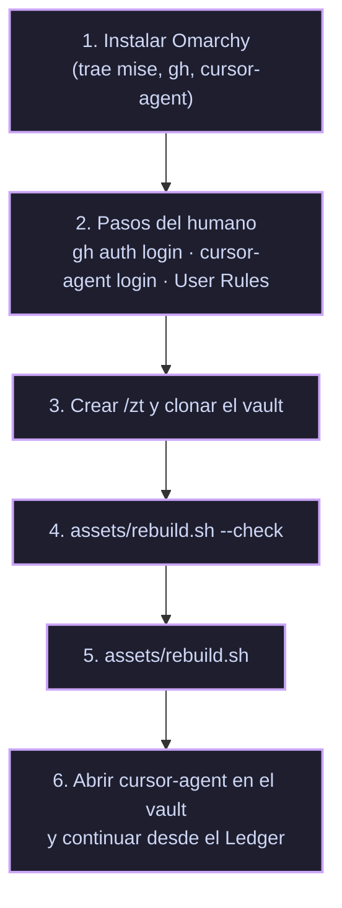

# 💻 Reconstruir en una PC Nueva

> [!NOTE]
> **Navegación:**
> * Anterior: [[10.3 - Archivo del Sitio how.nixfred.com|Archivo del Sitio]]
> * Volver a: [[00 - Indice General (MOC)|Índice General]]

Cómo dejar otra máquina en el mismo punto que esta, **hasta el último capítulo completado**, sin repetir la investigación. Se mantiene al día: cada capítulo que cambia la máquina actualiza esta nota y `assets/rebuild.sh` (regla en `AGENTS.md`).

> [!IMPORTANT]
> **Cubre hasta el Capítulo 4.** Lo que viene después (nixfredOS, Tailscale, repo privado `*-brain`) se añade aquí cuando se ejecute. Una vez exista el `*-brain`, en una PC nueva **se restaura `~/.claude` desde ese repo** (Capítulo 8) en lugar de reinstalar y volver a hacer la entrevista: la identidad no se recrea, se clona.

---

## 🧭 Orden



---

## 1. Omarchy

Instalar [Omarchy](https://omarchy.org). Su aprovisionamiento ya deja lo que este playbook necesita:

| Pieza | Cómo llega |
|---|---|
| `mise`, `gh`, `node` | Aprovisionamiento de Omarchy (`install/user/mise.sh`, `mise-work.sh`) |
| `bun` (nixfredOS lo necesita, 1.2+) | **No** lo trae Omarchy: `mise use -g bun` (el script lo hace si falta) |
| `cursor-agent` | `omarchy-mise-install cursor-agent` (`/usr/share/omarchy/install/user/mise.sh`), con backend `http` desde `downloads.cursor.com/lab/` |
| `~/.bashrc` | `env-bootstrap` + `$OMARCHY_PATH/default/bash/rc` + tu bloque propio |
| Tailscale (Capítulo 6) | `omarchy-install-service-tailscale`: paquete, `tailscaled`, `tailscale up --accept-routes`, operador = tu usuario y widget en la barra |

> [!CAUTION]
> **No ejecutes `claude`**, ni siquiera `claude --version`. En Omarchy, `~/.local/bin/claude` es un shim que corre `mise use -g claude` e **instala Claude Code** (pasó en el Capítulo 4). Lo mismo con los demás shims de agentes de Omarchy. Si ocurre: `mise unuse -g claude && mise uninstall claude --all` y borrar los enlaces sueltos en `~/.local/share/mise/installs/claude/`.

## 2. Pasos del humano

Nadie más puede hacerlos:

```bash
gh auth login          # GitHub.com → SSH → usar/crear la llave → navegador
cursor-agent login     # navegador; comprobar con: cursor-agent status
```

**User Rules de Cursor** (Settings → Rules → User Rules). Viven en la cuenta de Cursor, así que con la misma cuenta ya están. Con otra cuenta, pegar estas seis:

```text
The default branch is always `master`. Do not use `main`.
```
```text
Never commit directly to `master`. The only exception is the repository's initial commit. - For every change after that: create an auxiliary branch, push it, open a pull request into `master`, and merge via that PR.
```
```text
Before merging, rebase the auxiliary branch onto the latest `master` so history stays linear. - After the PR is fully merged, delete the auxiliary branch locally and on the remote.
```
```text
Never add yourself as a co-author. Do not add `Co-authored-by` trailers, and never attribute commits to `robert-flo` together with `Cursor` / `CursorAgent`.
```
```text
Lead with choices: when a decision is mine to make, offer 2-4 concrete options (multi-select when it fits), each set capped with "or type your own". An off-menu answer is still my answer; never bounce me back to the menu. Menu the hard parts and jump in with choices when I stall. No menus for routine steps.
```
```text
My terminal level is advanced: don't explain routine commands or ask before running them. Stop only at irreversible steps (deleting data, overwriting files, rewriting published history, changing repo visibility, spending money) and at decisions only I can make.
```

> [!NOTE]
> `~/.cursor/rules/` **no** sirve como sustituto: `cursor-agent` no lo carga de forma global (prueba con canario en el [[01.3 - Capitulo 3 - Hablar en Opciones|Capítulo 3]]).

## 3. `/zt` y el vault

`/zt` es el directorio compartido de experimentos (grupo `wheel`, setgid y ACL por defecto). Hay que crearlo antes de clonar, porque el vault vive dentro:

```bash
sudo install -d -m 2770 -o root -g wheel /zt
sudo setfacl -m g:wheel:rwx,d:g:wheel:rwx /zt
git clone --recurse-submodules git@github.com:robert-flo/PJ-LARRY-rf-playbook.git \
  /zt/2026-10-12-robert-flo-PJ-LARRY-rf-playbook
cd /zt/2026-10-12-robert-flo-PJ-LARRY-rf-playbook
```

## 4–5. `assets/rebuild.sh`

```bash
assets/rebuild.sh --check   # solo revisa: ✓ hecho · • pendiente · ✗ bloqueante
assets/rebuild.sh           # aplica lo pendiente; repetible sin efectos dobles
```

| Paso | Qué hace | Capítulo |
|---|---|---|
| 0 | Comprueba Omarchy, `git`, `gh`, `jq`, `mise`, `curl`; instala `bun` y `cursor-agent` con mise si faltan | Paso 0 |
| 1 | Comprueba `gh` y `cursor-agent` autenticados (no los hace) | Paso 0 |
| 2 | Copia `statusline.sh` y fusiona `cli-config.fragment.json` (barra de estado, atribución desactivada), con backup | Cap. 2 |
| 3 | Crea `/zt` si falta y añade el bloque `try` a `~/.bashrc` (`assets/home/bashrc.zt-try.snippet`) | Preparación |
| 4 | Inicializa el submódulo `nixfredOS/` y su remoto `upstream` (push `DISABLE`) | Preparación |
| 5 | Clona los 9 forks en `~/Projects/<repo>` (SSH, rama `personal`, `upstream` con push `DISABLE`) | Cap. 4 |
| 6 | Instala nixbash en modo capa desde el fork | Paso 0 |
| 7 | Compila `fabric` desde `~/Projects/Fabric` con un Go temporal de mise | Cap. 4 |

Verificado el 2026-10-12: en esta máquina todo sale ✓, y con un `HOME` vacío reporta cada paso como pendiente o bloqueante.

> [!WARNING]
> **`XDG_CONFIG_HOME` mueve la configuración de `cursor-agent`.** Si está definida, la configuración vive en `$XDG_CONFIG_HOME/cursor/`; si no, en `~/.cursor/`. El script usa la misma regla.

## 6. Continuar

```bash
cd /zt/2026-10-12-robert-flo-PJ-LARRY-rf-playbook
cursor-agent --force
```
```text
Lee AGENTS.md y PROGRESO (Ledger).md de este vault y continúa el playbook donde lo dejamos.
```

---

## ✅ Decisiones ya tomadas (no volver a preguntarlas)

| Decisión | Valor | Dónde |
|---|---|---|
| Harness | `cursor-agent`, no Claude Code | Inicio |
| Base | nixfredOS (no LifeOS), desde el fork, submódulo del vault | Inicio |
| Forks | `PJ-LARRY-fo-<Repo>`, rama `personal`, nunca PR a upstream | Preparación |
| Modo de permisos | `--force` | [[01.0 - Paso 0 - Desde Cero con cursor-agent\|Paso 0]] |
| Plan | Cursor Pro, pagado por un año | Paso 0 |
| Shell | nixbash como **capa** sobre el bashrc de Omarchy | Paso 0 |
| Tailscale | Capítulo 6 | Paso 0 |
| Nivel del humano | Avanzado | [[01.1 - Capitulo 1 - El Paradigma de la Terminal\|Cap. 1]] |
| Atribución del agente | Desactivada (commits y PRs) | [[01.2 - Capitulo 2 - Primera Sesion\|Cap. 2]] |
| Carpeta de datos de nixfredOS | `~/.claude` | [[02.4 - Capitulo 4 - El Stack de Larry\|Cap. 4]] |
| Ollama | Se decide en el Capítulo 11 | Cap. 4 |
| Fabric CLI | Instalado ya; `fabric --setup` en el último paso, apuntando al fork | Cap. 4 |

---

## ⚠️ Trampas conocidas

| Trampa | Qué pasa | Qué hacer |
|---|---|---|
| Shim `claude` de Omarchy | Instala Claude Code al invocarlo | No ejecutarlo (ver arriba) |
| `DetectEnv` de nixfredOS | Reporta `claude-code` por `~/.claude/` (skills de Omarchy) + el shim | `--config-root ~/.claude` explícito; rama "otro harness" del `INSTALL.md` |
| Forks sin releases ni tags | Instaladores de "última release" fallan contra el fork | Instalar desde el clon local o compilar |
| Trailer `Co-authored-by: Cursor` | El entorno del agente del IDE lo añade a los commits | `git log -1 --format=%B` antes de cada push; quitarlo con `git commit-tree` (`AGENTS.md`) |
| nixbash con `NIXBASH_REPLACE` sin definir en Omarchy | Antes del PR #1 reemplazaba `~/.bashrc` | Usar siempre el instalador del fork (`personal`) |
| Pruebas con `HOME` temporal | `XDG_DATA_HOME`/`XDG_CONFIG_HOME` siguen apuntando al home real | Redefinirlos también al probar |
| `askQuestion` en `-p` | El menú se salta solo (nadie contesta) | Probar menús en sesión interactiva |
| Barra de estado con tabuladores | `read` colapsa campos vacíos | Delimitador `\x1f` (ya en `statusline.sh`) |
| `ls` con alias a eza | Salida rara en scripts | `command ls` |
| Push HTTPS sin credenciales | "could not read Username" | Remotos SSH tras `gh auth login` con SSH |

---

## 🔗 Próximos Pasos

- [[PROGRESO (Ledger)|📒 PROGRESO (Ledger)]]: dónde vamos.
- [[10.2 - Repositorios Upstream y Forks|10.2 — Repositorios Upstream y Forks]]
- [[00 - Indice General (MOC)|🏠 Volver al Índice General]]
