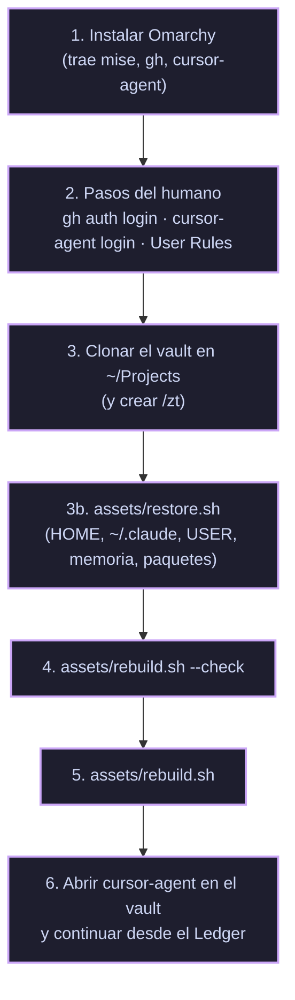

# 💻 Reconstruir en una PC Nueva

> [!NOTE]
> **Navegación:**
> * Anterior: [[10.3 - Archivo del Sitio how.nixfred.com|Archivo del Sitio]]
> * Volver a: [[00 - Indice General (MOC)|Índice General]]

Cómo dejar otra máquina en el mismo punto que esta, **hasta el último capítulo completado**, sin repetir la investigación. Se mantiene al día: cada capítulo que cambia la máquina actualiza esta nota y `assets/rebuild.sh` (regla en `AGENTS.md`).

> [!IMPORTANT]
> **Cubre hasta el Capítulo 11** (nixfredOS adaptado a `cursor-agent`, Tailscale, repos privados, recuperación, configuración personal de Sura, proyectos en `~/Projects` y memoria con extracción y búsqueda semántica). Los repos ya existen (`sura-brain`, `sura-brain-user`, `sura-conversations`, `sura-home`): en una PC nueva **se restauran** con `assets/restore.sh` antes de `rebuild.sh`, porque la identidad no se recrea, se clona. Probado de punta a punta en el usuario de pruebas `melitta` ([[02.8 - Capitulo 8 - Recuperacion ante Desastres|Capítulo 8]]).

---

## 🧭 Orden



---

## 1. Omarchy

Instalar [Omarchy](https://omarchy.org). Su aprovisionamiento ya deja lo que este playbook necesita:

| Pieza | Cómo llega |
|---|---|
| `mise`, `gh`, `node` | Aprovisionamiento de Omarchy (`install/user/mise.sh`, `mise-work.sh`) |
| `bun` (nixfredOS lo necesita, 1.2+) | **No** lo trae Omarchy: `mise use -g bun` (el script lo hace si falta) |
| `cursor-agent` | `omarchy-mise-install cursor-agent` (`/usr/share/omarchy/install/user/mise.sh`), con backend `http` desde `downloads.cursor.com/lab/` |
| `~/.bashrc` | `env-bootstrap` + `$OMARCHY_PATH/default/bash/rc` + tu bloque propio |
| Tailscale (Capítulo 6) | `omarchy-install-service-tailscale`: paquete, `tailscaled`, `tailscale up --accept-routes`, operador = tu usuario, Taildrop, widget en la barra y webapp. `rebuild.sh` (paso 13) lo lanza y añade Tailscale SSH |

> [!CAUTION]
> **No ejecutes `claude` antes del paso 8 de `rebuild.sh`**, ni siquiera `claude --version`. En Omarchy, `~/.local/bin/claude` es un shim que corre `mise use -g claude` e **instala Claude Code** (pasó en el Capítulo 4). El paso 8 lo sustituye por una guardia que rechaza y registra cada llamada en `~/.local/state/claude-guard.log`. Si se instaló por accidente: `mise unuse -g claude && mise uninstall claude --all` y borrar los enlaces sueltos en `~/.local/share/mise/installs/claude/`.

## 2. Pasos del humano

Nadie más puede hacerlos:

```bash
gh auth login          # GitHub.com → SSH → usar/crear la llave → navegador
cursor-agent login     # navegador; comprobar con: cursor-agent status
```

**User Rules de Cursor** (Settings → Rules → User Rules). Viven en la cuenta de Cursor, así que con la misma cuenta ya están. Con otra cuenta, pegar estas seis:

```text
The default branch is always `master`. Do not use `main`.
```
```text
Never commit directly to `master`. The only exception is the repository's initial commit. - For every change after that: create an auxiliary branch, push it, open a pull request into `master`, and merge via that PR.
```
```text
Before merging, rebase the auxiliary branch onto the latest `master` so history stays linear. - After the PR is fully merged, delete the auxiliary branch locally and on the remote.
```
```text
Never add yourself as a co-author. Do not add `Co-authored-by` trailers, and never attribute commits to `robert-flo` together with `Cursor` / `CursorAgent`.
```
```text
Lead with choices: when a decision is mine to make, offer 2-4 concrete options (multi-select when it fits), each set capped with "or type your own". An off-menu answer is still my answer; never bounce me back to the menu. Menu the hard parts and jump in with choices when I stall. No menus for routine steps.
```
```text
My terminal level is advanced: don't explain routine commands or ask before running them. Stop only at irreversible steps (deleting data, overwriting files, rewriting published history, changing repo visibility, spending money) and at decisions only I can make.
```

> [!NOTE]
> `~/.cursor/rules/` **no** sirve como sustituto: `cursor-agent` no lo carga de forma global (prueba con canario en el [[01.3 - Capitulo 3 - Hablar en Opciones|Capítulo 3]]).

## 3. El vault en `~/Projects`

Todos los proyectos viven en `~/Projects/<repo>` ([[03.10 - Capitulo 10 - Proyectos, Roles y Referencias|Capítulo 10]]). El vault y el submódulo son públicos, así que se clonan por HTTPS antes de tener la llave SSH (llega con `restore.sh`):

```bash
git clone --recurse-submodules https://github.com/robert-flo/PJ-LARRY-rf-playbook.git ~/Projects/PJ-LARRY-rf-playbook
cd ~/Projects/PJ-LARRY-rf-playbook
# después de restore.sh:
git remote set-url origin git@github.com:robert-flo/PJ-LARRY-rf-playbook.git
```

`/zt` (directorio compartido de experimentos para `try`, grupo `wheel`, setgid y ACL por defecto) lo crea `rebuild.sh` en el paso 3.

## 3b. `assets/restore.sh`

```bash
assets/restore.sh --check   # qué restauraría
assets/restore.sh           # sura-home (dotbare), paquetes de ~/.config/pkglist, sura-brain, árbol USER, sura-conversations, bun install
```

Necesita `gh auth login` hecho (clona por HTTPS con el helper de `gh`: la llave SSH llega dentro de `sura-home`). Reescribe `/home/gracie` → `$HOME` si el usuario es otro (`RESTORE_FROM_HOME` para cambiar el origen). `--no-push` deja los cuatro repos sin push (banco de pruebas). Detalle y trampas en la [[02.8 - Capitulo 8 - Recuperacion ante Desastres|nota del Capítulo 8]].

## 4–5. `assets/rebuild.sh`

```bash
assets/rebuild.sh --check   # solo revisa: ✓ hecho · • pendiente · ✗ bloqueante
assets/rebuild.sh           # aplica lo pendiente; repetible sin efectos dobles
```

| Paso | Qué hace | Capítulo |
|---|---|---|
| 0 | Comprueba Omarchy, `git`, `gh`, `jq`, `mise`, `curl`; instala `bun` y `cursor-agent` con mise si faltan | Paso 0 |
| 1 | Comprueba `gh` y `cursor-agent` autenticados (no los hace) | Paso 0 |
| 2 | Copia `statusline.sh`, `statusline-usage.sh` y `statusline-nixfredos.sh` y fusiona `cli-config.fragment.json` (barra de estado, atribución desactivada), con backup | Cap. 2 |
| 3 | Crea `/zt` si falta y añade el bloque `try` a `~/.bashrc` (`assets/home/bashrc.zt-try.snippet`) | Preparación |
| 4 | Inicializa el submódulo `nixfredOS/` y su remoto `upstream` (push `DISABLE`) | Preparación |
| 5 | Clona los 9 forks en `~/Projects/<repo>` (SSH, rama `personal`, `upstream` con push `DISABLE`) | Cap. 4 |
| 6 | Instala nixbash en modo capa desde el fork | Paso 0 |
| 7 | Compila `fabric` desde `~/Projects/Fabric` con un Go temporal de mise | Cap. 4 |
| 8 | Sustituye el shim `claude` por la guardia (`assets/home/.local/bin/claude`): rechaza el uso interactivo y, desde el Cap. 11, responde las llamadas `--print` con `cursor-agent` en un `HOME` aislado | Cap. 5 / 11 |
| 9 | nixfredOS Core: copia el submódulo a `~/.claude/skills/nixfredOS` (con snapshot previo) y ejecuta `DeployCore`, `InstallSettings`, `ScaffoldUser` + `LinkUser`, `ActivateImports`, `InstallHooks`, `DeployComponents` e `interviewdue` | Cap. 5 |
| 10 | Memory engine: instalador, `memory.db` recreada con `mem init`, `mem` en el PATH y placeholders de identidad (`assets/nixfredos-substitute.ts`) | Cap. 5 |
| 11 | Adaptadores de Cursor: `~/.cursor/hooks.json`, `mcp.json`, scripts de `~/.cursor/hooks/`, envoltura de hooks (`wrap-claude-hooks.sh`) y timer `cursor-transcripts-sync` | Cap. 5 |
| 12 | Extras: espeak-ng, piper + voz `es_MX-claude-high`, `voice.json`, Interceptor 2.1.0 | Cap. 5 |
| 13 | Tailscale: `omarchy-install-service-tailscale` si no está conectado (el humano abre la URL de login y pulsa **Connect**), operador, Tailscale SSH, MagicDNS, Taildrop y widget | Cap. 6 |
| 14 | Repos para siempre: gitleaks, dotbare, `gup`, `brain-backup.sh` + timer, bloque dotbare/`wgup` en `~/.bashrc`, y comprobación de que los cuatro repos son `PRIVATE` y están conectados | Cap. 7 |
| 15 | Recuperación: `pkglist-dump` y el hook de pacman que mantiene `~/.config/pkglist/{pacman,aur}.txt` | Cap. 8 |
| 16 | Proyectos: clona en `~/Projects/<repo>` cada fila de `USER/PROJECTS.md` que falte (la lista vive en el repo privado, no en el vault) | Cap. 10 |
| 17 | Memoria: `LMF4_EXTRACT_MODEL=auto` (environment.d + `~/.bashrc`), Ollama con `nomic-embed-text` (solo `127.0.0.1`) y timer `memory-embed` | Cap. 11 |

Verificado el 2026-10-12: en esta máquina todo sale ✓, y con un `HOME` vacío reporta cada paso como pendiente o bloqueante (los paquetes del sistema y las unidades systemd salen ✓ porque no dependen de `HOME`).

> [!IMPORTANT]
> **Identidad si no se restaura desde `sura-brain-user`.** El paso 9 crea el árbol USER vacío. Antes de seguir, edita `~/.config/NIXFREDOS/USER/CONFIG/NIXFREDOS_CONFIG.toml`, `DIGITAL_ASSISTANT/DA_IDENTITY.md` y `PRINCIPAL/PRINCIPAL_IDENTITY.md` como en la [[02.5 - Capitulo 5 - nixfredOS en cursor-agent|nota del Capítulo 5]] (Sura / Robert / `America/El_Salvador`) y vuelve a ejecutar `rebuild.sh`: la sustitución del paso 10 lee los nombres de ese TOML. Después, la configuración personal del [[03.9 - Capitulo 9 - Configurar, no Chatear|Capítulo 9]] (`BASICINFO.md`, `ABOUTME.md`, `OPERATIONAL_RULES.md`).

> [!NOTE]
> **Pasos del humano del Capítulo 5:** `codex login`; instalar la [extensión de Interceptor](https://chromewebstore.google.com/detail/interceptor/gomcpnagjjlhehnkoobkjgnkbleiooed) en un perfil de prueba de Chrome y fijar `INTERCEPTOR_TEST_CONTEXT_ID` en `~/.claude/skills/Interceptor/preferences.env`; `CLOUDFLARE_API_TOKEN` en `~/.claude/.env`.

> [!WARNING]
> **`XDG_CONFIG_HOME` mueve la configuración de `cursor-agent`.** Si está definida, la configuración vive en `$XDG_CONFIG_HOME/cursor/`; si no, en `~/.cursor/`. El script usa la misma regla.

## 6. Continuar

```bash
cd ~/Projects/PJ-LARRY-rf-playbook
cursor-agent --force
```
```text
Lee AGENTS.md y PROGRESO (Ledger).md de este vault y continúa el playbook donde lo dejamos.
```

---

## ✅ Decisiones ya tomadas (no volver a preguntarlas)

| Decisión | Valor | Dónde |
|---|---|---|
| Harness | `cursor-agent`, no Claude Code | Inicio |
| Base | nixfredOS (no LifeOS), desde el fork, submódulo del vault | Inicio |
| Forks | `PJ-LARRY-fo-<Repo>`, rama `personal`, nunca PR a upstream | Preparación |
| Modo de permisos | `--force` | [[01.0 - Paso 0 - Desde Cero con cursor-agent\|Paso 0]] |
| Plan | Cursor Pro, pagado por un año | Paso 0 |
| Shell | nixbash como **capa** sobre el bashrc de Omarchy | Paso 0 |
| Tailscale | Script de Omarchy, Tailscale SSH (sin `sshd`), solo esta PC por ahora | [[02.6 - Capitulo 6 - Tailscale\|Cap. 6]] |
| Nivel del humano | Avanzado | [[01.1 - Capitulo 1 - El Paradigma de la Terminal\|Cap. 1]] |
| Atribución del agente | Desactivada (commits y PRs) | [[01.2 - Capitulo 2 - Primera Sesion\|Cap. 2]] |
| Carpeta de datos de nixfredOS | `~/.claude` | [[02.4 - Capitulo 4 - El Stack de Larry\|Cap. 4]] |
| Ollama | Solo para embeddings (`nomic-embed-text`); la inferencia de fondo va por el adaptador `claude` → `cursor-agent` (modelo `composer-2.5`) | [[03.11 - Capitulo 11 - Memoria Viva\|Cap. 11]] |
| Fabric CLI | Instalado ya; `fabric --setup` en el último paso, apuntando al fork | Cap. 4 |
| Asistente / principal | **Sura** / **Robert**, `America/El_Salvador` | [[02.5 - Capitulo 5 - nixfredOS en cursor-agent\|Cap. 5]] |
| Constitución | Hook nativo `sessionStart` de Cursor | Cap. 5 |
| Shim `claude` | Guardia que rechaza | Cap. 5 |
| Extras | Todos menos Claude Code y lo exclusivo de macOS | Cap. 5 |
| Memoria | Camino de nixfredOS (SQLite local + repo privado); Honcho descartado | Cap. 5 |
| `RememberTrigger` | En inglés ("remember …") | Cap. 5 |
| Repos privados | `sura-brain`, `sura-brain-user`, `sura-conversations` (backup automático directo a `master`) y `sura-home` (dotbare, rama + PR) | [[02.7 - Capitulo 7 - Repos Privados para Siempre\|Cap. 7]] |
| Secretos en los backups | Incluidos, como Larry (repos privados) | Cap. 7 |
| Manifiesto de paquetes | Hook de pacman → `~/.config/pkglist/`, versionado en `sura-home` | [[02.8 - Capitulo 8 - Recuperacion ante Desastres\|Cap. 8]] |
| Banco de pruebas | Usuario permanente `melitta` en esta PC (restore con `--no-push`) | Cap. 8 |
| Idioma | Español en conversación y notas; inglés en código, comentarios y commits | [[03.9 - Capitulo 9 - Configurar, no Chatear\|Cap. 9]] |
| Estilo y lista de calidad | Los de nixfredOS sin cambios | Cap. 9 |
| Correcciones permanentes | Sura las escribe en el árbol USER sin preguntar y avisa | Cap. 9 |
| Proyectos | Todo en `~/Projects/<repo>` (vault incluido); `/zt` solo para experimentos; registro en `USER/PROJECTS.md` | [[03.10 - Capitulo 10 - Proyectos, Roles y Referencias\|Cap. 10]] |
| Barra de estado | La de `cursor-agent` + segmento corto de nixfredOS (`Sura mem 40 · hooks ✓ · voz on`) | Cap. 5 |

---

## ⚠️ Trampas conocidas

| Trampa | Qué pasa | Qué hacer |
|---|---|---|
| Shim `claude` de Omarchy | Instala Claude Code al invocarlo | No ejecutarlo antes del paso 8 (guardia) |
| `install.sh` / alias `nixfredos` | Acaban lanzando `claude` | Instalar con `rebuild.sh` (herramientas de `Tools/`) |
| Hooks de prompt de Claude en Cursor | No corren sin un `beforeSubmitPrompt` nativo; el texto plano se descarta; >10.000 caracteres se descarta todo | `claude-hooks-gate.sh` + `wrap-claude-hooks.sh` (repetir tras reinstalar nixfredOS) |
| `substituteTree` | Ignora claves sin llaves; antes de `InstallHooks` deja placeholders | `assets/nixfredos-substitute.ts`, al final |
| `memory.db` del instalador | Esquema viejo: `mem import` falla | `mem init` sobre una base nueva (paso 10) |
| `${userHome}` en `mcp.json` | `cursor-agent` no lo expande | `bash -c` con `$HOME` |
| Servicios systemd y `~/.local/bin` | Pulse no ve binarios de ahí | Enlaces en `/usr/local/bin` |
| Login de Tailscale | Tener la consola abierta no da de alta la PC | Abrir la URL que imprime `tailscale up` y pulsar **Connect** |
| Reinstalar sin `tailscale logout` | Deja un dispositivo fantasma en la tailnet | `sudo tailscale logout` antes de formatear, o borrarlo en la consola |
| `find -size -1M` | Solo encuentra archivos vacíos | `-size -1024k` |
| Git y el symlink `NIXFREDOS/USER` | `~/.claude` no incluye la identidad | Repo propio `sura-brain-user` |
| `node_modules` de nixfredOS | Binarios de 143 MB: GitHub los rechaza | `node_modules/` en el `.gitignore` de `~/.claude` |
| `ssh` a la propia PC por Tailscale | `Connection refused` (el kernel lo entrega por `lo`) | Probar Tailscale SSH desde otro nodo |
| `DetectEnv` de nixfredOS | Reporta `claude-code` por `~/.claude/` (skills de Omarchy) + el shim | `--config-root ~/.claude` explícito; rama "otro harness" del `INSTALL.md` |
| Forks sin releases ni tags | Instaladores de "última release" fallan contra el fork | Instalar desde el clon local o compilar |
| Trailer `Co-authored-by: Cursor` | El entorno del agente del IDE lo añade a los commits | `git log -1 --format=%B` antes de cada push; quitarlo con `git commit-tree` (`AGENTS.md`) |
| nixbash con `NIXBASH_REPLACE` sin definir en Omarchy | Antes del PR #1 reemplazaba `~/.bashrc` | Usar siempre el instalador del fork (`personal`) |
| Pruebas con `HOME` temporal | `XDG_DATA_HOME`/`XDG_CONFIG_HOME` siguen apuntando al home real | Redefinirlos también al probar |
| `askQuestion` en `-p` | El menú se salta solo (nadie contesta) | Probar menús en sesión interactiva |
| Barra de estado con tabuladores | `read` colapsa campos vacíos | Delimitador `\x1f` (ya en `statusline.sh`) |
| `ls` con alias a eza | Salida rara en scripts | `command ls` |
| Push HTTPS sin credenciales | "could not read Username" | Remotos SSH tras `gh auth login` con SSH |
| Rutas `/home/gracie` en archivos restaurados | Otro usuario: `git` muere con `Permission denied` al incluir `delta.gitconfig` | Config de Git con `~/`; `restore.sh` reubica y usa `GIT_CONFIG_GLOBAL=/dev/null` |
| Token de `gh` | Vive en el keyring, no en `hosts.yml`: no viaja en `sura-home` | `gh auth login` en cada PC |
| `rebuild.sh` como segundo usuario | `tailscale set --operator` le roba el operador al primero | El paso 13 ya no cambia un operador ajeno |
| Tablas de decisiones/LoA en cero | Sin motor: la guardia rechaza `claude` y `SessionExtract` busca Ollama `llama3.1:8b` | Adaptador + `LMF4_EXTRACT_MODEL=auto` (paso 17) |
| Alias `g` de nixbash | Una función `g()` se vuelve `git()` recursiva y cuelga la terminal | Otro nombre (`dg`) o `command git` |
| Plantillas de `ScaffoldUser` | `BASICINFO.md`, `ABOUTME.md` y `Principal:` de `DA_IDENTITY.md` dicen `User` e inglés | Revisarlos (Cap. 9) |
| Timers restaurados por dotbare | Symlink `enabled` pero el timer no corre | El paso 14 exige también `is-active` |

---

## 🔗 Próximos Pasos

- [[PROGRESO (Ledger)|📒 PROGRESO (Ledger)]]: dónde vamos.
- [[10.2 - Repositorios Upstream y Forks|10.2 — Repositorios Upstream y Forks]]
- [[00 - Indice General (MOC)|🏠 Volver al Índice General]]
